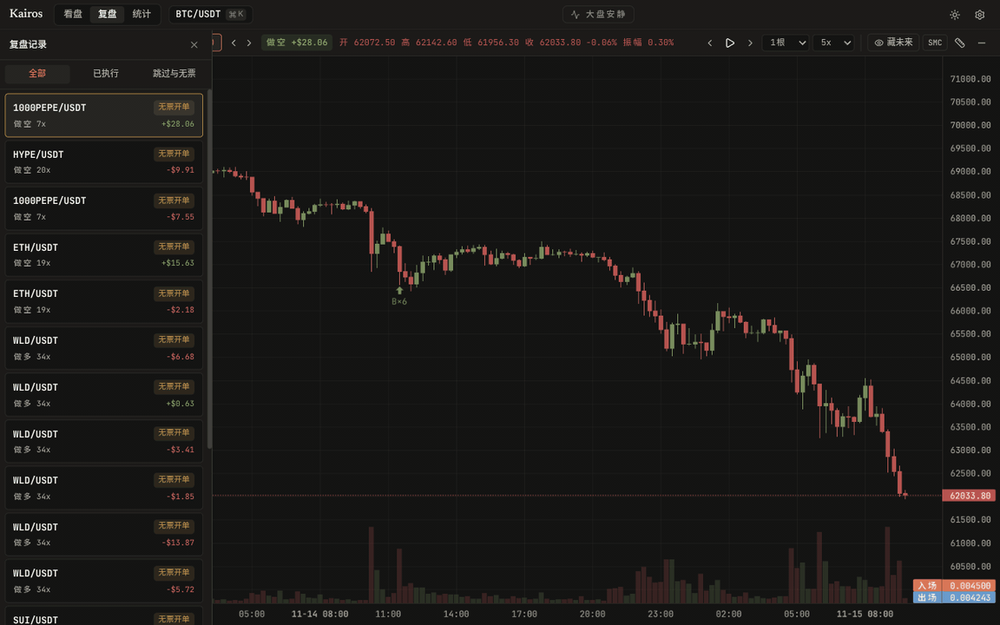
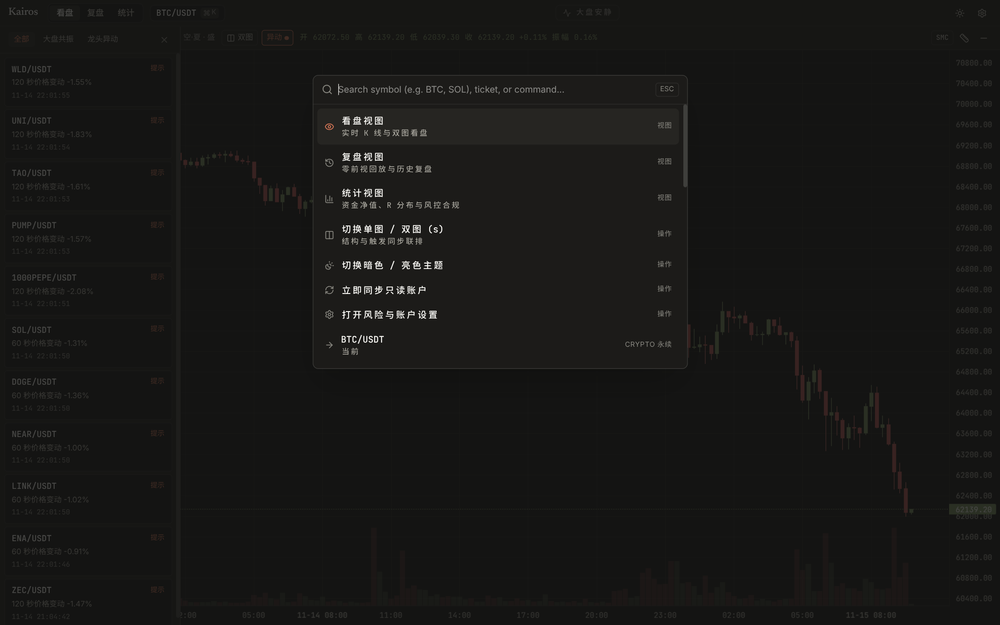
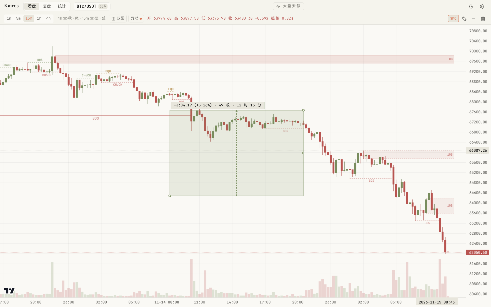

# Kairos — 人控加密货币合约异动监控与零前视复盘终端

> καιρός — 关键时刻，恰当时机

[](go.mod)
[](desktop/package.json)
[](internal/cache/store.go)
[](desktop/src/utils/format.ts)
[](docs/10-doctrine/KAIROS_DOCTRINE.md)
[](LICENSE)

**Kairos** 是一套面向加密货币永续合约的**人控决策闭环系统**，沿 `Observe → Interpret → Select → Decide → Execute → Learn` 六步主干运转：后端实时扫描市场广度与硬数据异动，通过本地桌面终端 **Kairos Desk** 完成多周期看盘、因果结构分析、零前视历史复盘与只读账户对账。系统**不使用 LLM 判定方向，也不接管实盘下单**——所有观察、挑选、定仓与进出场拍板均由人类完成；独立采集器、取证与现货挂单项目保留在各自仓库，本仓只留进入决策票与复盘账本的主线。


---

## 核心特性 (Core Capabilities)

### 1. 大盘脉冲 (`MarketPulse`) 与 Top-100 反庄宇宙
- **纯加密市值主干**：优先接入 CoinGecko `/api/v3/coins/markets`（CoinGlass `/api/marketCapRank` 兜底）筛选市值 Top-100 纯加密标的，自动排除稳定币与黄金/美股/大宗商品永续合约（基于合约 `underlyingType` 过滤 `EQUITY`/`COMMODITY`）。
- **反庄门禁与迟滞窗口**：严格校验 `上市 ≥ 30d`、存在现货 USDT 交易对、`24h 成交额 ≥ $15M`、`OI ≥ $15M`、`OI/MCap ≤ 0.50` 与 `24hVol/OI ≤ 20.0`（Top-20 放宽至 `35.0`），并对已在榜标的施加 `0.75x` 迟滞窗口防止边界频繁抖动。
- **Vasicek 收缩 Beta 残差排名**：基于各币种与 BTC 60s 收益率配对回归并 50/50 收缩至 `1.0`（钳制 `[0.4, 2.2]`）的 Beta 残差 Z-score，实时排出横截面领涨 (`Leaders`) 与领跌 (`Laggards`)。

### 2. Kairos Desk 桌面看盘工作台 (`Watch / Review / Stats`)
- **Warm Obsidian 暗色 & Warm Parchment 纸感双主题**：围绕暖黑曜石与暖羊皮纸语义色阶设计，长时间盯盘低视觉疲劳。
- **`< 10ms` SQLite WAL 热缓存**：K 线落盘本地 `desktop-cache.db`（WAL + 内存临时表）并配合前端切片缓存，周期切换近乎零延迟；向左拖动/滚动按 `before_ts` 无限拉取历史 K 线。
- **上下双图跨周期同步联排**：快捷键 `s` 一键切换双图模式，独立配置上下标的与周期（如 `BTC/USDT 15m` + `ETH/USDT 1h`），十字线与可视时间轴双向联动。
- **因果无重绘 `SMC` 市场结构**：基于 `Swing 50 / Internal 5` 识别 `BOS` / `CHoCH` 结构突破、ATR 消融过滤后的未回补 `Order Block` 及 `EQH` / `EQL` 等高/低流动性位，严格只依赖当前及历史已收盘柱体。
- **持久化 `尺子` 与 `水平线`**：画线与测距结果实时持久化至 SQLite `drawings` 表，跨周期切换、右键点击、切换标的或重启均保留，仅在手动点击工具栏 `垃圾桶` 时清空。
- **全图表严格 `Asia/Shanghai (UTC+8)` 时间轴**：主图 K 线 X 轴、十字线浮标、复盘游标与资金净值曲线统一锁定北京时间。

### 3. 零前视历史复盘 (`Zero-Lookahead Bar Replay`)



- **`藏未来` 物理截断**：开启 `藏未来` 后，后端 `/api/v1/replay/state` 严格截断游标时间戳 `cursor_ts` 之后的所有 K 线、画线、异动、通知与成交记录；未收盘的高周期 K 线仅由 `≤ cursor_ts` 的 `1m` 数据逐分钟合成，彻底消除未来函数。
- **逐根推演与锚点还原**：支持 `Space` 自动播放/暂停、`←/→` 单步前后推进、`a/n` 跳转至异动锚点，并在图表上还原实盘买卖成交 `B` / `S` 标记及入场、止损、出场价格参考线。

### 4. 币安只读账户对账与风控统计 (`Read-Only Account Sync & Stats`)
- **本地 `0600` 凭据隔离**：只读 API 凭据仅写入 `~/.config/kairos/secrets.env`（`0600` 权限，支持弹窗 `KEY SECRET` 一键粘贴自动拆分），仅调用只读 `GET` 接口（`/fapi/v2/account`、`/fapi/v2/positionRisk`、`/fapi/v1/income`、`/fapi/v1/userTrades`），禁止交易与提现权限。
- **并发增量同步与 FIFO 归集**：并发拉取账户余额、持仓、90 天资金流水与多窗口回补成交，按 `(symbol, positionSide)` 以 FIFO 规则自动归集完整开平仓生命周期。
- **定高零抖动净值对账**：`Stats` 工作区展示累计净盈亏、平均 R 倍数、风控合规率、支持钱包余额对比与回撤 `%` 切换的定高零抖动资金净值曲线（`EquityCurve`），以及 `R` 倍数区间分布直方图。

### 5. 教义 9b 行为红线 (`BehaviorGate`)
- 将 `docs/10-doctrine/KAIROS_DOCTRINE.md` §9b 规则机械化落地至票据与风控状态检查：强制逐仓（拒绝全仓）、机械杠杆上限（BTC/ETH `≤ 10x`、山寨 `≤ 5x`）、单笔预设最大止损预算与结构止损依据校验、同币亏损冷却期（默认 `45m`）、24h 同点位试错预算（第 4 票硬拒）以及 24h 连损刚性锁仓（连损 `≥ 2` 笔或累计试错 `≤ -1.5R`，不可覆盖）。

---

## 界面总览 (Screenshots)

| 看盘 · 上下双图同步 + SMC + 持久化尺子/水平线 | 看盘 · 大盘脉冲队列 + `⌘K` 纯加密搜索 |
| :---: | :---: |
|  |  |
| **复盘 · `藏未来` 零前视推演与成交点标注** | **统计 · 资金净值对账曲线与 R 分布** |
|  |  |

### Warm Parchment 纸感亮色主题对比



---

## 六步主干与系统架构 (Spine & Architecture)

```text
Observe → Interpret → Select → Decide → Execute → Learn
```

| 步骤 | 组件 | 仓库位置 |
|---|---|---|
| **Observe** | MarketPulse / 单币检测器 / `kairos-oiscan` | `internal/detector` · `cmd/kairos-oiscan` |
| **Interpret** | CycleMap（Context 1d+4h / Setup 1h+15m / Trigger 5m） | `internal/cycle` |
| **Select** | Directional Ranker | `internal/ranker` |
| **Decide** | Playbook → Decision Ticket → BehaviorGate（教义 9b 行为红线机械执法） | `internal/playbook` · `internal/opportunity` · `internal/decision` |
| **Execute** | 人类最终决策（经 `kairos-desk` 记录 + gate 判定，手动下单） | `cmd/kairos-desk` · `desktop/` |
| **Learn** | Journal → Counterfactual → FIFO 实盘对账 → EV Attribution → Gate 合规报告 | `internal/storage` · `internal/evaluation` · `cmd/kairos-eval` · `tools/research` |

> 加任何东西前先问：**它属于六步哪一步？** 回答不出来就先别加；独立采集与执行工具不搬入本仓。

### 系统数据流架构

```text
Binance / OKX WS & REST ──→ 单币检测器（价格速度 / 成交量 / OI / 资金费率）
                        ──→ MarketPulse（Top-100 反庄宇宙 / 横截面状态机 / Vasicek Beta 排名）
                                 │
CoinGecko / CoinGlass ───────────┼──→ kairosd（核心守护进程）
（市值权重 / 可选多空比与爆仓）   │     ├──→ Telegram / DingTalk（经 AlertGate 镜像推送）
                                 │     ├──→ events + 60s snapshots JSONL ──→ kairos-calibrate（lift_5m）
                                 │     ├──→ trading-journal.jsonl ──→ kairos-eval / tools/research（DuckDB）
                                 │     └──→ desktop-cache.db (SQLite WAL) + deskapi (127.0.0.1 HTTP/WS)
                                 │                │
                                 │                ▼
                                 │          Kairos Desk（Electron + React 19 + Lightweight Charts）
                                 │          看盘(双图/SMC/尺子) · 复盘(藏未来) · 统计(只读对账/R分布)
                                 │
kairos-oiscan ───────────────────┴──→ 全市场 OI 异动扫描 ──→ data/inbound/futures/*.jsonl
```

### 仓库布局 (Project Layout)

```text
cmd/              CLI 与守护进程入口（kairosd / kairos-desk / kairos-eval / kairos-calibrate / kairos-market-replay / kairos-oiscan）
internal/         Go 核心引擎（cache / config / cycle / data / decision / deskapi / detector / engine / evaluation / exchange / notice / notify / opportunity / playbook / ranker / storage / types / utils）
desktop/          Kairos Desk 桌面端（Electron 主进程 + React 19 + Vite + Tailwind + Lightweight Charts）
config/           运行时配置示例（config/config.yaml.example）
tools/research/   JSONL → DuckDB 只读研究分析与评测层
schemas/          统一事件契约（event.v1.json）
scripts/          辅助脚本（coinglass_fetch.py）
docs/             权威链与策略知识库（入口 docs/INDEX.md）
```

> 独立仓库（不再放于本仓树内）：`kairos-bus` · `pm-bot` · `rh-sniper` · `smartalpha` · `meme-monitor` · `aicoin-api` · `chain-trace` · `trader` · `coinglass-decrypt`

### 二进制组件清单

| 命令 | 源码目录 | 核心职责 |
|---|---|---|
| `kairosd` | `cmd/kairosd` | 实时 WebSocket 异动监控、MarketPulse 状态机、Telegram/DingTalk 推送与本地 Desk API 服务 |
| `kairos-desk` | `cmd/kairos-desk` | 人类决策 CLI：查询会话/票据/候选、BehaviorGate 机械校验与决策落盘 |
| `kairos-eval` | `cmd/kairos-eval` | 交易账本 EV 归因汇总与 BehaviorGate 合规报告 |
| `kairos-calibrate` | `cmd/kairos-calibrate` | 联结事件、结果与 60s 横截面快照，校准 `lift_5m` 阈值基线 |
| `kairos-market-replay` | `cmd/kairos-market-replay` | MarketPulse 影子算法 JSONL 夹具离线回放（不推 Telegram） |
| `kairos-oiscan` | `cmd/kairos-oiscan` | 全市场合约 OI 异动两阶段发现与确认扫描，输出至 `data/inbound/futures/` |

### 实时检测与脉冲告警维度

| 维度 | 数据来源 | 检测方式 |
|---|---|---|
| `price_velocity` | WebSocket | 多窗口绝对涨跌幅阈值（默认 60s `0.9%` / 120s `1.4%`） |
| `volume_spike` | WebSocket | 按秒归一化成交速率对比滚动基线倍数 |
| `open_interest_change` | REST | 相邻轮询未平仓量变化率阈值 |
| `funding_rate_anomaly` | REST | 资金费率绝对值阈值 + 变化幅度 |
| `long_short_ratio` | CoinGlass | 绝对阈值 + Z-score + 变化速度（可选） |
| `liquidation` | CoinGlass | 爆仓金额阈值 + Z-score + 多空主导判定（可选） |
| `resonance` | 聚合器 | 多维度共振质量分 `≥ 55`（极端度 + 维度数 + 方向一致性 + 上下文） |
| `market_impulse` / `market_trend` / `market_stress` / `market_decay` | 横截面 | 广度 + 中位收益 + BTC/ETH 确认 + 状态机（默认 shadow 模式） |

---

## 快速开始 (Quick Start)

### 1. 运行 Kairos Desk 桌面终端

```bash
# 1) 安装依赖并构建前端资源
cd desktop && pnpm install && pnpm run build && cd ..

# 2) 构建后端守护进程（可选：desktop 启动时也会自动探测仓库根目录 ./kairosd）
go build -o kairosd ./cmd/kairosd

# 3) （可选）配置只读币安账户同步凭据，仅保留查询权限（严禁交易/提现权限）
mkdir -p ~/.config/kairos
cat <<'EOF' > ~/.config/kairos/secrets.env
BINANCE_READONLY_API_KEY=<YOUR_BINANCE_READONLY_API_KEY>
BINANCE_READONLY_API_SECRET=<YOUR_BINANCE_READONLY_API_SECRET>
EOF
chmod 600 ~/.config/kairos/secrets.env

# 4) 启动 Kairos Desk（自动拉起本地 kairosd --desk-listen 127.0.0.1:0）
cd desktop && pnpm run desktop
```

> 若需独立运行后端并另行连接桌面端，可先执行 `./kairosd --config config/config.yaml --desk-listen 127.0.0.1:18790`（或使用默认只做告警推送的 `./kairosd --config config/config.yaml`）。

### 2. 预编译发布版 (GitHub Releases)

每次推送版本标签（`v*`）或手动触发 Release 工作流后，[GitHub Releases](https://github.com/ArchdevilForge/kairos/releases) 会自动发布全平台压缩包（含 6 个二进制文件与 `config/config.yaml.example`）：

```bash
# 以 Linux amd64 为例
tar xzf kairos-*-linux-amd64.tar.gz
cd kairos-*-linux-amd64

export TELEGRAM_BOT_TOKEN="<YOUR_TELEGRAM_BOT_TOKEN>"
export TELEGRAM_CHAT_ID="<YOUR_TELEGRAM_CHAT_ID>"
# 可选：钉钉自定义机器人镜像推送
# export DINGTALK_WEBHOOK_URL="https://oapi.dingtalk.com/robot/send?access_token=<YOUR_ACCESS_TOKEN>"
# export DINGTALK_SECRET="<YOUR_DINGTALK_SECRET>"

./kairosd --config config/config.yaml.example
```

### 3. CLI 常用命令与质量门禁

```bash
# 决策与评估 CLI
go run ./cmd/kairos-desk gate <ticket-id>
go run ./cmd/kairos-eval gate
go run ./cmd/kairos-calibrate --config config/config.yaml
go run ./cmd/kairos-market-replay --input internal/detector/testdata/broad_rally.jsonl
go run ./cmd/kairos-oiscan --help

# 质量门禁（本地与 CI 一致）
make check        # build + vet + fmt-check + mod-check + golangci-lint + go test -race
make cover-check  # internal/... 测试覆盖率检查（>= 70%）
make check-all    # Go check + tools/research Python (uv + pytest)
```

---

## 快捷键速查表 (Shortcuts)

| 快捷键 | 作用域 | 功能 |
|---|---|---|
| `Ctrl/Cmd + K` | 全局 | 打开 / 关闭指令面板与纯加密永续标的搜索 |
| `1` – `5` | 看盘 | 快捷切换 K 线周期（`1m` / `5m` / `15m` / `1h` / `4h`） |
| `s` | 看盘 | 开启 / 关闭上下双图同步联排 |
| `j` / `k` | 看盘 | 在已展开的异动队列中向下 / 向上切换条目 |
| `Shift + 拖拽` | 图表 | 快速启用尺子测距并自动持久化保存 |
| `Space` | 复盘 | 播放 / 暂停零前视历史回放 |
| `←` / `→` | 复盘 | 逐根后退 / 前进推演 K 线 |
| `a` / `n` | 复盘 | 跳转至上一条 / 下一条异动或通知锚点 |
| `Esc` | 全局 / 局部 | 依次关闭指令面板、设置弹窗、异动抽屉、记录列表或退出当前画线工具 |

---

## 文档与权威链 (Documentation & Authority)

本仓采用严格的单线权威链，冲突时按 `KAIROS_DOCTRINE` > `20-models` > `30-playbooks` > `代码` 裁决：

- [文档总目录](docs/INDEX.md) — 全仓文档地图与六步主干导航
- [权威裁决图](docs/00-system/AUTHORITY.md) — `NORTH_STAR` → `KAIROS_DOCTRINE` → 模型 → Playbook → 运行时契约 → 研究证据
- [核心教义 (Canonical Freeze)](docs/10-doctrine/KAIROS_DOCTRINE.md) — 完整工作流、时间尺度角色与 §9b 行为硬规则唯一权威
- [领域术语表](CONTEXT.md) — Realtime Anomaly / Decision Ticket / Alert Gate / Behavior Gate 标准定义

---

## Philosophy

顺势而为 · 敬畏市场 · 严格止损 · 人工决策

## License

[MIT](LICENSE)
