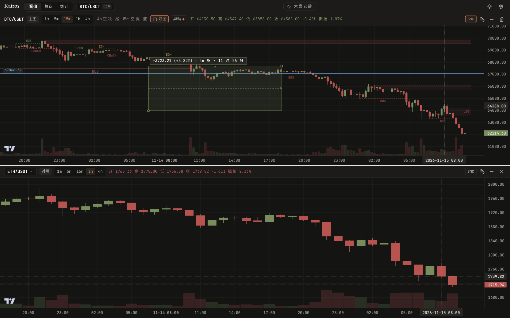
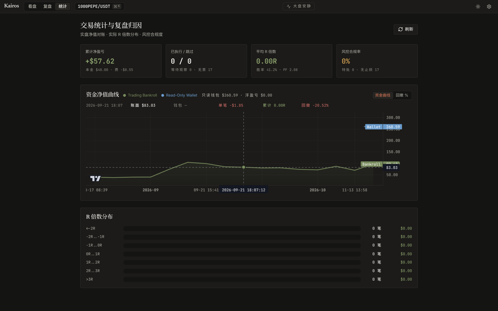

**中文** | [English](README.en.md)

# Kairos

**Kairos** 是专注 Crypto 短线合约的一站式看盘程序。

---

## 界面预览


| 看盘 · 双图同步与 SMC | 复盘 · 零前视推演 | 统计 · 净值对账与 R 分布 |
| :---: | :---: | :---: |
|  |  |  |

---

## 下载安装

在 [GitHub Releases](https://github.com/ArchdevilForge/kairos/releases) 下载对应平台的 **Kairos Desk** 预编译安装包（均内置 `kairosd` 后端 sidecar，附带 `SHA256SUMS.txt` 校验文件）：

| 平台 | 架构 | 安装包格式 |
| --- | --- | --- |
| Linux | x64 | `.AppImage` / `.tar.gz` |
| macOS | arm64 | `.dmg` / `.zip` |
| Windows | x64 | `.exe` / `.zip` |

---

## 快速开始

在本地从源码构建并启动桌面终端（需预先安装 Go 1.26+、Node.js 与 pnpm）：

```bash
go build -o kairosd ./cmd/kairosd
pnpm --dir desktop install && pnpm --dir desktop run build
pnpm --dir desktop run desktop
```

启动桌面端会自动拉起本地 `./kairosd` 进程，并按序读取 `config/config.yaml` 或 `~/.config/kairos/config.yaml`（可选配置文件模板见 [config/config.yaml.example](config/config.yaml.example)）。

---

License: [MIT](LICENSE)
