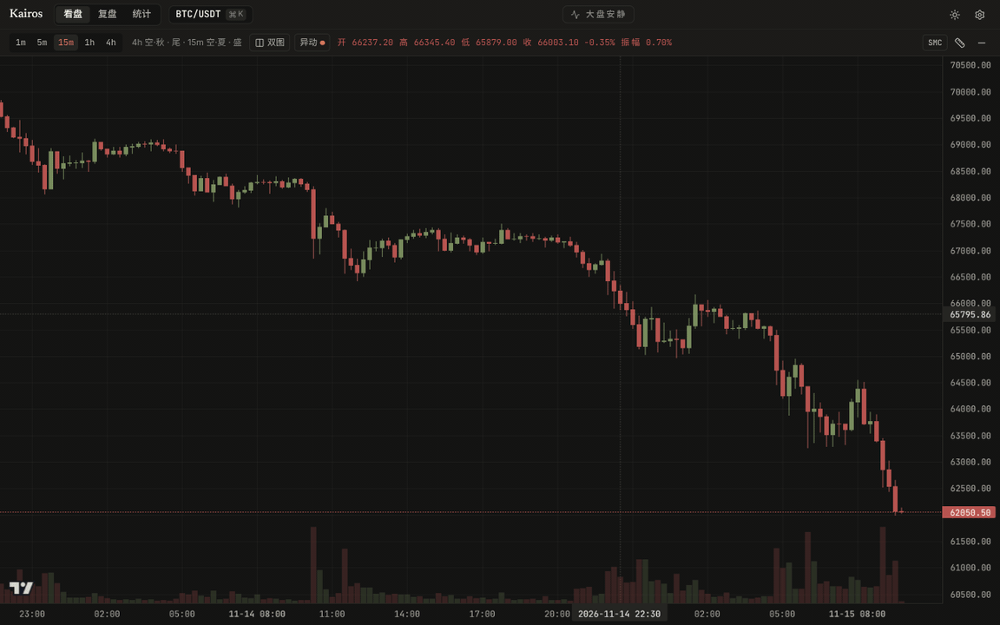
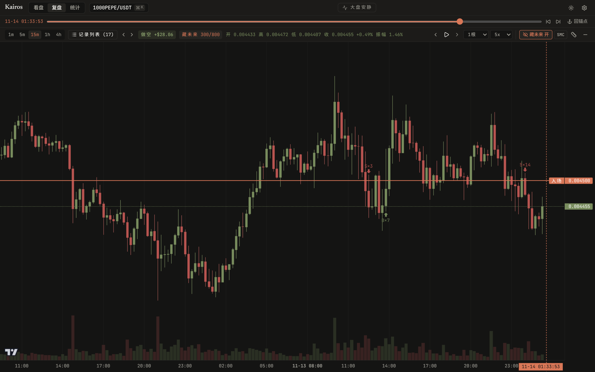

**English** | [中文](README.zh-CN.md)

# Kairos

**Kairos** is an all-in-one charting terminal focused on short-term crypto perpetuals.

---

## Screenshots



| Watch · Dual Chart & SMC | Review · Zero-Lookahead Replay | Stats · Reconciliation & R Distribution |
| :---: | :---: | :---: |
|  |  |  |

---

## Download & Install

Download prebuilt **Kairos Desk** packages (each bundled with the `kairosd` backend sidecar and `SHA256SUMS.txt` checksums) from [GitHub Releases](https://github.com/ArchdevilForge/kairos/releases):

| OS | Arch | Package Formats |
| --- | --- | --- |
| Linux | x64 | `.AppImage` / `.tar.gz` |
| macOS | arm64 | `.dmg` / `.zip` |
| Windows | x64 | `.exe` / `.zip` |

---

## Quick Start

Build and launch the desktop terminal from source (requires Go 1.26+, Node.js, and pnpm):

```bash
go build -o kairosd ./cmd/kairosd
pnpm --dir desktop install && pnpm --dir desktop run build
pnpm --dir desktop run desktop
```

Launching the desktop app starts the local `./kairosd` process automatically and reads `config/config.yaml` or `~/.config/kairos/config.yaml` (optional config template: [config/config.yaml.example](config/config.yaml.example)).

---

License: [MIT](LICENSE)
