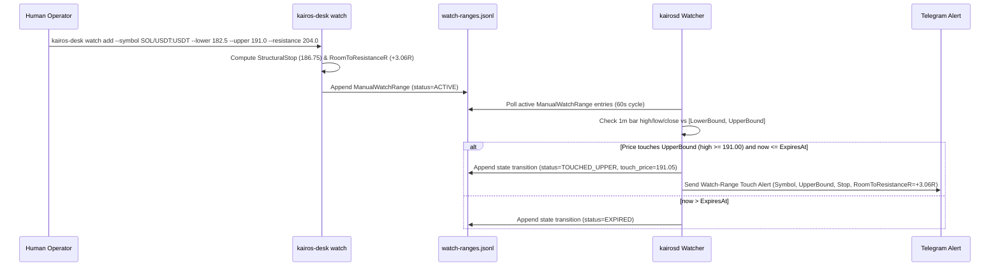

# Specification: `kairos-desk` Manual Watch-Range Entry (`RoomToResistanceR` & Touch Alert)

- **Status**: Draft Specification (Phase 2 H3 Kill-Rule Deliverable, Work Order Item 7)
- **Date**: 2026-11-10
- **Triggered By**: Experiment H3 Pre-Registered Kill Rule (`G_oos = 6 < 15` independent wave clusters; OOS NetR 95% CI lower bound `= -0.7935R < 0.0000R`)
- **Target Components**: `cmd/kairos-desk`, `internal/types`, `internal/storage`, `internal/opportunity`

---

## 1. Motivation & Scope Boundary

In **Experiment H3** (`tools/research/h3_experiment.py`), automatic multi-touch box maturity (`BOX_BREAKOUT`) and divergence/second-wave Stage-4 re-break (`SECOND_WAVE_STAGE4`) geometry recognizers were evaluated with causal $k=3$ bar swing-pivot confirmation lag (`15m` right-shoulder delay):

- **Out-of-Sample Independent Wave Clusters (`G_oos`)**: `6` (below the pre-registered minimum bar of `15`)
- **Out-of-Sample Full-Friction Mean NetR (`wave_k_be=0.8`)**: `-0.3792R` with 95% CI `[-0.7935R, +0.0352R]` (lower bound `< 0.0000R`)

Per **Work Order Item 7 (H3 KILL Rule)**:
> *"If out-of-sample independent wave clusters < 15 OR the NetR 95% CI lower bound < 0, do NOT build any automatic geometry recognizer. Deliver instead a spec for `kairos-desk` manual watch-range entry (operator-entered upper/lower bounds, system computes `RoomToResistanceR` and alerts on touch) as a document in the PR."*

Accordingly:
1. **Zero automatic geometry recognition** (`BoxTouchCount`, `ATRCompressionRatio`, `TriggerKnifeLock`, `RoomToResistanceR`) is wired into `CycleMap` in Phase 2.
2. Instead, the human operator visually identifies high-conviction horizontal consolidation boxes on the chart and registers the exact `[lower_bound, upper_bound]` watch range via `kairos-desk`.
3. The system deterministically computes `RoomToResistanceR` against the next 4h/1d structural resistance/support and alerts on boundary touch.

---

## 2. CLI Interface (`cmd/kairos-desk`)

Extend `kairos-desk` with a `watch` subcommand family:

```bash
# 1. Register a manual watch range (operator-entered lower & upper bounds)
kairos-desk watch add \
  --symbol SOL/USDT:USDT \
  --lower 182.50 \
  --upper 191.00 \
  --resistance 204.00 \
  --direction LONG \
  --stop-pct 1.5 \
  --ttl 24h \
  --note "4h 3-touch consolidation below 204 daily supply"

# 2. List active / historical manual watch ranges with computed RoomToResistanceR
kairos-desk watch list [--active-only] [--symbol SOL/USDT:USDT]

# 3. Cancel or remove a manual watch range
kairos-desk watch cancel <watch-id> --reason "structure invalidated"
```

### 2.1 CLI Input Validation Rules (Fail-Closed)

| Parameter | Requirement | Fail-Closed Error |
|---|---|---|
| `--symbol` | Non-empty canonical symbol (`BASE/USDT:USDT`) | `watch add: --symbol is required` |
| `--lower` | `lower > 0` | `watch add: --lower must be > 0` |
| `--upper` | `upper > lower` and `(upper - lower) / lower <= 0.25` | `watch add: --upper must exceed --lower (max box height 25%)` |
| `--direction` | `LONG`, `SHORT`, or `BOTH` (default `LONG`) | `watch add: invalid --direction` |
| `--resistance` | For `LONG`: `resistance > upper`; for `SHORT`: `resistance < lower` (if omitted, resolved from latest closed 4h/1d swing high/low) | `watch add: --resistance must lie beyond breakout boundary` |
| `--stop-pct` | `0.2 <= stop_pct <= 10.0` (default: midpoint of `[lower, upper]` capped by `stop_pct`) | `watch add: --stop-pct out of bounds [0.2%, 10.0%]` |
| `--ttl` | `15m <= ttl <= 168h` (default `24h`) | `watch add: --ttl must be between 15m and 168h` |

---

## 3. Deterministic `RoomToResistanceR` Calculation

When the operator enters `lower_bound` ($L$), `upper_bound` ($U$), and either provides `--resistance` ($R_{\text{htf}}$) or allows `kairos-desk` to query the nearest unmitigated closed 4h/1d candle high/low beyond the box:

### 3.1 Long Breakout at Upper Boundary ($U$)

1. **Structural Stop Price ($S_{\text{long}}$)**:
   - Default structural stop is placed at the box midpoint $M = \frac{U + L}{2}$, tightened by `--stop-pct` ($d_{\text{stop}}$) if specified:
     $$S_{\text{long}} = \max\left(\frac{U + L}{2},\; U \cdot \left(1 - \frac{d_{\text{stop}}}{100}\right)\right)$$
2. **Initial 1R Distance ($R_0$)**:
   $$R_0 = U - S_{\text{long}} > 0$$
3. **Room to Next 1d/4h Resistance in R (`RoomToResistanceR`)**:
   $$\text{RoomToResistanceR} = \frac{R_{\text{htf}} - U}{R_0}$$

### 3.2 Short Breakdown at Lower Boundary ($L$)

1. **Structural Stop Price ($S_{\text{short}}$)**:
   $$S_{\text{short}} = \min\left(\frac{U + L}{2},\; L \cdot \left(1 + \frac{d_{\text{stop}}}{100}\right)\right)$$
2. **Initial 1R Distance ($R_0$)**:
   $$R_0 = S_{\text{short}} - L > 0$$
3. **Room to Next 1d/4h Support in R (`RoomToResistanceR`)**:
   $$\text{RoomToResistanceR} = \frac{L - R_{\text{htf}}}{R_0}$$

### 3.3 Operator Feedback at Entry Time

Upon executing `kairos-desk watch add`, the CLI immediately prints the computed `RoomToResistanceR`:
- If `RoomToResistanceR < 1.50`: prints an explicit warning (`WARNING: RoomToResistanceR = 1.12R < 1.50R minimum recommended structural room; overhead 4h/1d resistance is too close`).
- If `RoomToResistanceR >= 1.50`: prints `OK: RoomToResistanceR = 2.84R (1R = 2.23%, stop = 186.75, target resistance = 204.00)`.

---

## 4. Data Model & JSONL Storage Schema

Records are persisted append-only in the journal directory (`watch-ranges.jsonl` alongside `trading-journal.jsonl`):

```go
// WatchRangeStatus represents the lifecycle state of an operator-entered watch box.
type WatchRangeStatus string

const (
	WatchRangeActive       WatchRangeStatus = "ACTIVE"
	WatchRangeTouchedUpper WatchRangeStatus = "TOUCHED_UPPER"
	WatchRangeTouchedLower WatchRangeStatus = "TOUCHED_LOWER"
	WatchRangeExpired      WatchRangeStatus = "EXPIRED"
	WatchRangeCancelled    WatchRangeStatus = "CANCELLED"
)

// ManualWatchRange is an operator-entered price box monitored for boundary touches.
type ManualWatchRange struct {
	SchemaVersion      int              `json:"schema_version"`
	RecordType         string           `json:"record_type"` // "manual_watch_range"
	ID                 string           `json:"id"`
	Symbol             string           `json:"symbol"`
	Direction          string           `json:"direction"`   // "LONG" | "SHORT" | "BOTH"
	LowerBound         float64          `json:"lower_bound"`
	UpperBound         float64          `json:"upper_bound"`
	StructuralStop     float64          `json:"structural_stop"`
	HTFResistance      float64          `json:"htf_resistance"`
	HTFResistanceTF    string           `json:"htf_resistance_tf"` // "4h" | "1d" | "manual"
	InitialOneRPct     float64          `json:"initial_1r_pct"`
	RoomToResistanceR  float64          `json:"room_to_resistance_r"`
	Status             WatchRangeStatus `json:"status"`
	Note               string           `json:"note,omitempty"`
	CreatedAt          int64            `json:"created_at"`
	ExpiresAt          int64            `json:"expires_at"`
	TouchedAt          int64            `json:"touched_at,omitempty"`
	TouchPrice         float64          `json:"touch_price,omitempty"`
	CancelReason       string           `json:"cancel_reason,omitempty"`
}
```

---

## 5. Touch Detection & Alert Workflow



### 5.1 Alert Payload Format

When an `ACTIVE` watch range is touched (`bar.High >= UpperBound` for `LONG`/`BOTH`, or `bar.Low <= LowerBound` for `SHORT`/`BOTH`), `kairosd` emits a single deduplicated alert:

```text
[WATCH-RANGE TOUCH] SOL/USDT:USDT (LONG)
Boundary Touched: Upper @ 191.00 (Last: 191.12)
Box Range:        [182.50, 191.00] (Width: 4.66%)
Structural Stop:  186.75 (1R = 2.23%)
Next 1d/4h Level: 204.00 (manual)
RoomToResistance: +3.06R
Operator Note:    4h 3-touch consolidation below 204 daily supply
```
